# Reuven Cohen (rUv): Open Source Agentic AI and Cognitum One

[Reuven Cohen](https://ruv.io/), known as **rUv** and **ruvnet** on GitHub, is the Founder and Chief AI Officer of [Cognitum One](https://cognitum.one/). The **ruvnet open source AI stack** provides agent orchestration, vector and graph memory, camera free WiFi sensing, portable runtimes, and agent evaluation.

* [Ruflo](https://github.com/ruvnet/ruflo): AI agent orchestration.
* [RuVector](https://github.com/ruvnet/RuVector): Vector search and agent memory.
* [RuView](https://github.com/ruvnet/RuView): WiFi spatial sensing.
* [Cognitum One](https://cognitum.one/): Commercial deployment and governance.
* [ruOS](https://ruos.cognitum.one/): Enterprise agent computers.

  
  
  
  
  
  

[](docs/ecosystem-metrics.md)

[](https://cognitum.one)

## Contrastive AI: learn what fits, detect what breaks

[Our contrastive AI approach](https://github.com/ruvnet/RuView/issues/87) combines similarity learning with structural checks: bring related observations together, separate mismatches, measure drift, and gate updates against explicit constraints. RuVector supplies the memory and graph substrate; agent harnesses use that context to guide and evaluate work. Performance and reliability depend on the workload and validation.

[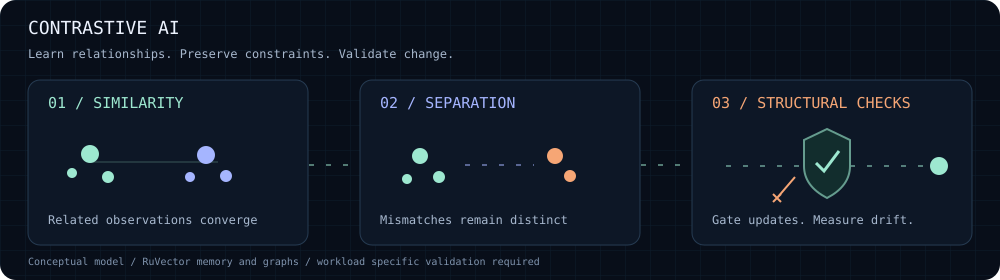](https://github.com/ruvnet/RuView/issues/87)

### A brief history of agentic engineering

Reuven Cohen's early agentic engineering work spans [AI tools and plugins in 2023](docs/ruvnet-prior-art.md), [SPARC development workflows](https://github.com/ruvnet/sparc), and the Claude Flow lineage that became [Ruflo](https://github.com/ruvnet/ruflo). That work evolved into coordinated swarms, adaptive memory, portable runtimes, and governed improvement through RuVector, RVF, RVM, and MetaHarness. [Dated evidence and scoped pioneering claims](docs/ruvnet-prior-art.md) document specific contributions alongside earlier related work.

## What is Cognitum One?

[Cognitum One](https://cognitum.one/) brings the open source ruvnet stack into enterprise hardware, software, deployment services, and governance systems. ruvnet is the public development ecosystem for experiments, reusable libraries, and community contributions; Cognitum One builds supported, sovereign deployments on that foundation.

The platform spans public cloud, customer infrastructure, and the low power edge. Private deployments can operate without external cloud services when the required models, dependencies, and integrations are available locally.

### How do System 0, System 1, and System 2 fit together?

| System | Role | Core technologies |
| :--- | :--- | :--- |
| **System 0: Sense & Respond** | Observe the physical environment and act locally | Cognitum Seed edge hardware, a WebAssembly (WASM) runtime, on device vector storage, and [Cognitum RuView](https://cognitum.one/ruview) WiFi Channel State Information (CSI) sensing |
| **System 1: Learn & Remember** | Ground work in local data and retain context | [RuVector](https://github.com/ruvnet/RuVector) memory and retrieval, with development tools for private data grounding |
| **System 2: Reason & Orchestrate** | Coordinate specialized agents and evaluate their work | [Ruflo](https://github.com/ruvnet/ruflo), [MetaHarness](https://github.com/ruvnet/metaharness), and enterprise deployment services |

[ruOS](https://ruos.cognitum.one/) provides the agentic desktop and execution environment connecting these capabilities to applications, files, and terminals.

### What is ruOS?

Cognitum One [announced ruOS on October 6, 2026](https://www.businesswire.com/news/home/20261006476353/en/). Teams of agents work inside managed Linux environments on infrastructure the customer controls, with persistent RuVector context, Ruflo coordination, and MetaHarness evaluation. Administrators define access, approval requirements, and action policies.

ruOS ships as a standard `.deb` package and supports local and virtual deployments. Restricted network and air gapped operation requires locally available models and dependencies. [Explore ruOS](https://ruos.cognitum.one/) · [Public ruOS repository](https://github.com/ruvnet/ruos) · [Cognitum repositories](https://github.com/cognitum-one)

### Leadership and advisors

[Reuven “rUv” Cohen](https://ruv.io/) is Founder and Chief AI Officer; [D. Christopher Keil](https://cognitum.one/team) is Founding CEO. Founding advisors and investors include Mark B. Templeton, former CEO of Citrix; Dr. Greg Lavender, former CTO of Intel; and John McKinley, former President of AOL Technologies.

Strategic advisors include Adrian Cockcroft, Sean Patterson, Tom Lounibos, Jason La Barbera, Stuart Kerr, and Mark Allen, MD, bringing experience across cloud architecture, product, capital, AI workforce adoption, growth, and healthcare. [Meet the team](https://cognitum.one/team) · [Advisory team announcement](https://www.businesswire.com/news/home/20260902303667/en/)

<strong>Connect your agents: federation, skills, CLI and MCP</strong>

> [!TIP]
> **Your team. Your agents. One federation.**
> Coordinate at [x.ruv.io](https://x.ruv.io) · [RuFlo federation dashboard](https://ruflo-federation.ruv.chatgpt.site/)
>
> **MCP:** ChatGPT uses `https://x.ruv.io/chatgpt/mcp`; Claude and service clients use `https://x.ruv.io/mcp`. Authorize when prompted. [Setup & details](https://github.com/ruvnet/ruflo/blob/main/.agents/skills/open-federation/SKILL.md).

> **Start with the RuV Stack:** [Install skills + marketplace](docs/entrypoint/INSTALL.md) · [CLI / MCP guide](plugins/ruvnet/docs/INSTALL.md#local-cli-and-mcp-companion) · [MetaHarness](https://github.com/ruvnet/metaharness)
> Claude Code: `/plugin marketplace add ruvnet/ruvnet`, then `/plugin install ruvnet@ruvnet`.
> Reviewed changes: `node plugins/ruvnet/bin/ruvnet.mjs changes 5 --kind security` · snapshot-bound exact evidence with auditable filters and continuation cursors · [Harness evidence](docs/self-improvement/2026-09-25.md)

This ecosystem is published through one developer account. Repositories can include community contributions, automation, generated artifacts, and imported history. The evidence files keep those categories separate.

  <a href="#what-is-cognitum-one">Cognitum One</a> ·
  <a href="#explore-the-constellation">Constellation</a> ·
  <a href="#meet-the-core-systems">Core systems</a> ·
  <a href="#choose-your-entry-point">Get started</a> ·
  <a href="#github-reach">Reach</a> ·
  <a href="#october-2026-update">What is new</a> ·
  <a href="#evidence-and-provenance">Evidence</a>

## Explore the constellation


**One ecosystem, many ways in.** Start with the problem you want to solve. Follow the constellation from observations to memory, coordinated work, portable execution, and evaluated outcomes.

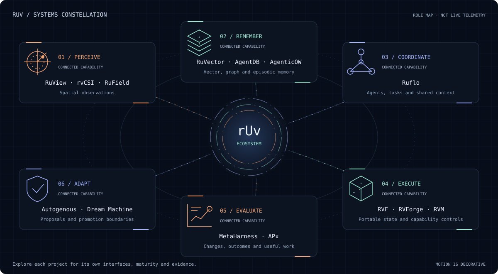

The connections describe complementary roles. Each project has its own interfaces, maturity, and evidence; this is a conceptual map, not a claim that every system is already integrated.


## Meet the core systems

| Project | What it does | Documentation |
| :--- | :--- | :--- |
| [Ruflo (formerly Claude Flow)](https://github.com/ruvnet/ruflo) | Coordinates AI agents, swarms, tasks, and shared context | [Agent orchestration documentation](https://github.com/ruvnet/ruflo#readme) |
| [RuVector](https://github.com/ruvnet/RuVector) | Provides vector search, graph intelligence, and agent memory | [Vector memory documentation](https://github.com/ruvnet/RuVector#readme) |
| [RuView](https://github.com/ruvnet/RuView) | Uses WiFi signals for spatial sensing without cameras | [Sensing setup and hardware requirements](https://github.com/ruvnet/RuView#readme) |
| [MetaHarness](https://github.com/ruvnet/metaharness) | Generates agent harnesses and evaluates proposed changes | [Harness documentation](https://github.com/ruvnet/metaharness#readme) |
| [RVF (RuVector Format)](https://www.npmjs.com/package/@ruvector/rvf) | Packages portable memory, payloads, and evidence | [RVF format and limitations](#rvf-memory-that-travels-with-its-evidence) |
| [RVM](https://github.com/ruvnet/rvm) | Runs workloads under capability controls | [Runtime documentation](https://github.com/ruvnet/rvm#readme) |

  <a href="https://github.com/ruvnet/RuView" title="Perceive"></a>
  <a href="https://github.com/ruvnet/RuVector" title="Remember"></a>
  <a href="https://github.com/ruvnet/ruflo" title="Coordinate"></a>
  <a href="https://github.com/ruvnet/rvm" title="Execute"></a>
  
  

Perceive · Remember · Coordinate · Execute · Evaluate · Adapt

<table>
<tr>
<td width="50%"><a href="https://github.com/ruvnet/ruflo">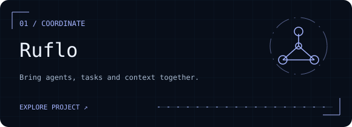</a></td>
<td width="50%"><a href="https://github.com/ruvnet/RuVector"></a></td>
</tr>
<tr>
<td><a href="https://github.com/ruvnet/RuView">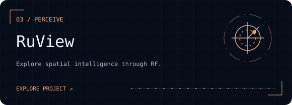</a></td>
<td><a href="https://github.com/ruvnet/metaharness">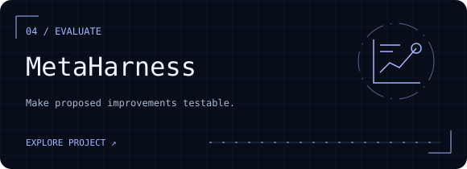</a></td>
</tr>
<tr>
<td><a href="#rvf-memory-that-travels-with-its-evidence">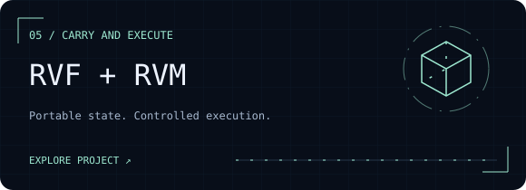</a></td>
<td><a href="https://github.com/ruvnet/autogenous"></a></td>
</tr>
</table>

[All layers and related projects](#how-the-stack-fits-together) · [Package inventory](docs/ruvnet-packages.md) · [Installation guide](docs/entrypoint/INSTALL.md)

### Expand the constellation

Follow the surrounding projects into persistent memory, spatial evidence, review workflows, and useful work measurement.

<table>
<tr>
<td width="50%"><a href="https://github.com/ruvnet/agentdb"></a></td>
<td width="50%"><a href="https://github.com/ruvnet/agenticow"></a></td>
</tr>
<tr>
<td width="50%"><a href="https://github.com/ruvnet/rvcsi"></a></td>
<td width="50%"><a href="https://github.com/ruvnet/rufield"></a></td>
</tr>
<tr>
<td width="50%"><a href="https://github.com/ruvnet/dream-machine"></a></td>
<td width="50%"><a href="https://github.com/ruvnet/APx"></a></td>
</tr>
</table>

## Choose your entry point


| I want to… | Start here | Then explore |
| --- | --- | --- |
| Coordinate agents around a real task | [Ruflo](https://github.com/ruvnet/ruflo) | [Stack installation](docs/entrypoint/INSTALL.md) and [CLI / MCP guide](plugins/ruvnet/docs/INSTALL.md#local-cli-and-mcp-companion) |
| Add retrieval or persistent memory | [RuVector](https://github.com/ruvnet/RuVector) | [AgentDB](https://github.com/ruvnet/agentdb) and [RVF](#rvf-memory-that-travels-with-its-evidence) |
| Explore spatial sensing | [RuView](https://github.com/ruvnet/RuView) | [rvCSI](https://github.com/ruvnet/rvcsi) and the project's hardware and validation requirements |
| Evaluate a proposed improvement | [MetaHarness](https://github.com/ruvnet/metaharness) | [Harness evidence](docs/self-improvement/2026-09-25.md) and [APx](https://github.com/ruvnet/APx) |
| Inspect what the public numbers mean | [Machine readable metrics](data/metrics.json) | [Counting rules](#read-the-metrics-correctly), [proof](docs/proof/2026-10-02.md), and [visual source guide](docs/visual-profile.md) |

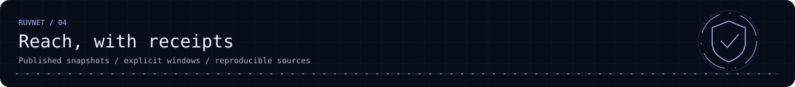

The dashboard above is generated from this repository's published JSON. Downloads are events, stars cover owned public nonfork repositories, and the project traces connect only two measured snapshots. The dates and counting rules below are part of the numbers.

<!-- github-public-metrics:start -->
## GitHub reach

Public GitHub API snapshot verified **October 10, 2026 UTC**. [Captured inventory](data/snapshots/2026-10-10/github-inventory.json).

| Measure | Verified value |
| --- | ---: |
| Followers | 11,726 |
| Public repositories | 222 |
| Owned public nonfork repositories | 196 |
| Public repositories that are forks | 26 |
| Stars across owned public nonfork repositories | 187,869 |
| Aggregate downstream forks of owned nonfork repositories | 25,122 |

### Flagship repository traction

| Project | Stars | Forks | Subscribers |
| --- | ---: | ---: | ---: |
| [RuView](https://github.com/ruvnet/RuView) | 97,106 | 12,756 | 870 |
| [ruflo](https://github.com/ruvnet/ruflo) | 74,236 | 8,826 | 458 |
| [RuVector](https://github.com/ruvnet/RuVector) | 4,555 | 611 | 37 |
| [agentic-flow](https://github.com/ruvnet/agentic-flow) | 818 | 178 | 14 |
| [metaharness](https://github.com/ruvnet/metaharness) | 696 | 88 | 3 |

RuView and Ruflo account for **91.2% of owned public nonfork stars** and **85.9% of downstream forks**.
<!-- github-public-metrics:end -->

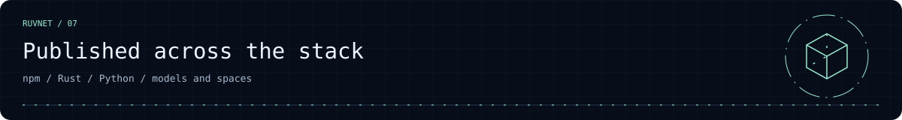

<!-- package-public-metrics:start -->
## Package distribution

| Measure | Verified value | Evidence date |
| --- | ---: | --- |
| Published registry and Hugging Face artifacts | at least 908 | Mixed dates below |
| Known npm packages listing `ruvnet` as maintainer | at least 398 | 2026-10-10 UTC |
| npm downloads, rolling 365 days (2025-10-09 through 2026-10-08) | 94,500,218 | 2026-10-10; 398 package cohort |
| Rust crates owned by `ruvnet` | 480 | 2026-10-10 UTC |
| Cumulative Rust crate downloads (verified 2026-10-10) | 1,815,085 | 2026-10-10 UTC |
| Ownership verified PyPI packages | 8 | July 12, 2026; historical |
| Hugging Face models, spaces, and datasets | 22 | July 12, 2026; historical |

The npm inventory and download evidence cover the same **398 package cohort**, verified **2026-10-10 UTC**. [Registry evidence](data/registry-stats.json) records both populations. The artifact total combines current npm and crates counts with the 30 historically verified PyPI and Hugging Face artifacts.

Package downloads include CI, reinstallations and platform packages. They do not establish unique users. The [weekly refresh](.github/workflows/refresh-registry-metrics.yml) updates these measurements from official APIs.
<!-- package-public-metrics:end -->

<!-- registry-download-chart:start -->
## npm download growth

[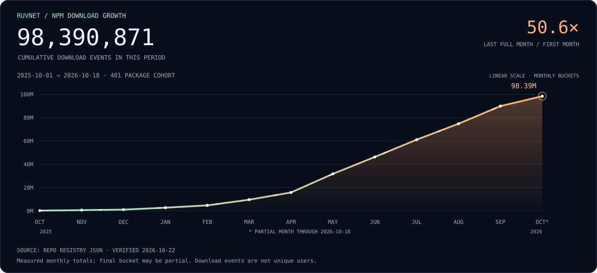](data/registry-stats.json)

**94,534,735 download events** accumulated from **2025-10-01 through 2026-10-08** across the verified **398 package cohort**. Complete month volume grew **50.6 times**, comparing 2025-10 with 2026-09.

The curve sums measured monthly downloads on a linear scale. The final month is partial, through **2026-10-08**. It is cumulative within this period, not lifetime downloads. The rolling annual total above uses a different date window. Verified **2026-10-10 UTC**.

Inspect monthly downloads and cumulative totals

| Month | Monthly events | Cumulative events |
| --- | ---: | ---: |
| 2025-10 | 299,028 | 299,028 |
| 2025-11 | 401,442 | 700,470 |
| 2025-12 | 430,107 | 1,130,577 |
| 2026-01 | 1,672,584 | 2,803,161 |
| 2026-02 | 1,970,435 | 4,773,596 |
| 2026-03 | 4,889,360 | 9,662,956 |
| 2026-04 | 6,176,221 | 15,839,177 |
| 2026-05 | 15,967,146 | 31,806,323 |
| 2026-06 | 14,465,413 | 46,271,736 |
| 2026-07 | 14,825,512 | 61,097,248 |
| 2026-08 | 13,680,577 | 74,777,825 |
| 2026-09 | 15,120,919 | 89,898,744 |
| 2026-10 (partial) | 4,635,991 | 94,534,735 |

**Source:** [published registry snapshot](data/registry-stats.json), collected from the official npm daily range API. Includes scoped, unscoped and platform packages. Download events include CI and reinstalls; they are not unique users.
<!-- registry-download-chart:end -->

<!-- registry-reporting-status:start -->
**Reporting coverage, 2026-10-10 UTC:** These npm figures are observed lower bounds across the known 398-package maintainer cohort. The latest positive cohort day is **2026-10-08**. The full daily-range responses contain 7 internal all-zero cohort days (2026-07-12, 2026-08-14, 2026-09-03, 2026-09-07, 2026-09-08, 2026-09-15, 2026-10-06); these may be reporting gaps. The trailing all-zero day 2026-10-09 is excluded from the reported-through date. No missing downloads are estimated. [Per-package range evidence](data/snapshots/2026-10-10/npm-downloads.json).
<!-- registry-reporting-status:end -->

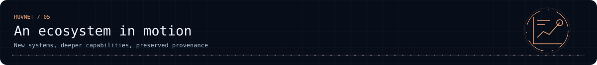

## October 2026 update

September was about connecting the parts. An agent needs somewhere to work, memory it can carry forward, and a way to show what happened. The work increasingly lives in those connections: Ruflo inside the coding session, RVF between sessions, RuVector behind the memory, and MetaHarness around the decision to keep a change.

Ruflo 3.50.0 brings Mods into that loop: prompt routing, tool checks, edit learning, cost controls, and a live swarm pane. The published release keeps Mods opt in and preserves classic hooks as the fallback. Later main commits add default installation and marketplace repair. The release and the moving branch are different evidence points.

RVF gives that continuity a concrete form. Memory, metadata, model payloads, and provenance can travel together in a file that a receiver can inspect. RVForge adds authoring, validation, and target staging. The useful boundary is simple: carrying a capability does not grant permission to execute it.

The six new public repositories extend the same idea. APx measures accepted work against a human reference. rGi keeps an agent loop durable across restarts. rultra brings governed adaptation to a Pi sensor box. MCP Studio makes the tools accessible through an application. ruPet and Agents of the Dawm explore a more human interface to the work, with the latter still a design proposal.

The direction is continuous software with an accountable history. More useful work, less repeated setup, and evidence that survives the session that produced it.

### New public projects

Creation dates are GitHub metadata. Status is scoped to the inspected source revision; stars use the October 2 UTC inventory.

| Project | Created | What it adds | Status | Stars |
| --- | --- | --- | --- | ---: |
| [agents-of-the-dawm](https://github.com/ruvnet/agents-of-the-dawm/blob/ffdf270c94d50af8c0057f96268d9d6ef2b2484c/README.md) | 2026-09-24 | Game design research | Design proposal | 0 |
| [ruPet](https://github.com/ruvnet/ruPet/blob/ec2737995cdf74ef28a59ddd6d38e1c721fe0636/README.md) | 2026-09-22 | Desktop companion | Published asset package | 9 |
| [mcp-studio](https://github.com/ruvnet/mcp-studio/blob/1de79b28e679ea39937df54586cc9bdcffdf4cdc/README.md) | 2026-09-17 | MCP application starter | Runnable application starter | 2 |
| [rultra](https://github.com/ruvnet/rultra/blob/03e4a7e039c9ee6e47193f77127d8d35f7830ed2/README.md) | 2026-09-11 | Governed edge sensing | Hardware prototype with published observations | 9 |
| [APx](https://github.com/ruvnet/APx/blob/4fb3093329c0839ad95a3033ec2553513c3351ea/README.md) | 2026-09-08 | Agentic productivity measurement | Runnable harness; synthetic tutorial | 4 |
| [rGi](https://github.com/ruvnet/rGi/blob/2dd6adb526a7ca1d27b1c4d6cf98c828b390c421/README.md) | 2026-09-08 | Persistent agent runtime | Experimental runtime | 3 |

### Existing systems, new capabilities

| System | October evidence | Boundary |
| --- | --- | --- |
| [Ruflo 3.50.0](https://github.com/ruvnet/ruflo/releases/tag/v3.50.0) | Mods, swarm pane, and ruOS jobs integration | Release reports 16 Mods, 38 swarm, and 3 ruOS engine tests; not rerun for this profile |
| [RuVector KGE 0.2.0](https://www.npmjs.com/package/@ruvector/kge/v/0.2.0) | Local knowledge graph scoring, training, evaluation and governed optimization | HolE and RotatE are established methods; training data and evaluation determine usefulness |
| [RuVector edge services](https://github.com/ruvnet/RuVector/blob/5a93328f2fceb0307c25929ed38cd7a0911fdf00/docs/adr/ADR-351-ruvector-edge-multitenant-services.md) | Cloudflare service implementation and documented deployment evidence | ADR preserves remaining authorization, capacity, and client acceptance gates |
| [MetaHarness improvement verifier](https://github.com/ruvnet/metaharness/blob/9ce8b8dd89045c3b9a1f809ae58f3589029db4a4/packages/flywheel/src/multigeneration-proof.ts) | Evidence classification across descendant generations, controls and reviewer receipts | Verifier behavior does not establish recursive self improvement |

[Full proof record](docs/proof/2026-10-02.md) · [Commit and package receipts](data/proof-2026-10-02.json) · [October provenance delta](docs/ruvnet-prior-art.md#october-2026-provenance-delta)

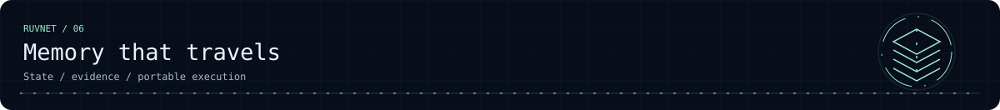

## RVF: memory that travels with its evidence


**RVF is RuVector Format.** It packages segmented vector memory, metadata, model and compute payloads, lineage, and witness records. The aim is to carry useful state from a browser to a local runtime or a governed service without rebuilding the context at every step.

| Piece | Responsibility | Evidence |
| --- | --- | --- |
| RVF format and SDK | Read, write, inspect and query portable memory | [SDK 0.3.4](https://www.npmjs.com/package/@ruvector/rvf/v/0.3.4), published July 28 |
| Wire contract | Preserve exact segment and manifest bytes across readers | [Golden byte tests](https://github.com/ruvnet/RuVector/blob/5a93328f2fceb0307c25929ed38cd7a0911fdf00/crates/rvf/rvf-wire/tests/wire_contract_golden.rs) |
| Witness evidence | Bind recorded actions, outcomes, costs and policy results; detect tampering | [Witness integration tests](https://github.com/ruvnet/RuVector/blob/5a93328f2fceb0307c25929ed38cd7a0911fdf00/crates/rvf/rvf-runtime/tests/witness_e2e.rs) |
| RVForge | Author, validate and stage a canonical RVF for target platforms | [RVForge 0.2.0](https://www.npmjs.com/package/@ruvector/rvforge/v/0.2.0), published August 5 |
| Ruflo integration | Portable agent memory and session persistence workflows | [RVF plugin contract](https://github.com/ruvnet/ruflo/blob/1c78a51d42166cc111e5c24bcf0bb89c51295105/plugins/ruflo-rvf/README.md) |

An artifact checksum proves which bytes were examined. A valid signature binds those bytes to a key. Neither proves that the recorded observation is true, that an experiment generalizes, or that execution is authorized. Verification needs a trusted key, an explicit policy, and evidence for the actual workload.

RVForge's current local build produces staged bundles. Native installer assembly, platform signing, and runtime validation are separate steps. Backend support varies across RVF native and WASM implementations. Ruflo's session encryption is opt in and does not automatically encrypt exported RVF bytes. These limits are part of the [published contracts](https://github.com/ruvnet/RuVector/blob/5a93328f2fceb0307c25929ed38cd7a0911fdf00/npm/packages/rvforge/README.md).

## How the stack fits together

**RuView, rvCSI, and RuField perceive. Ruflo coordinates. RuVector and AgenticOW remember. RVF carries state and evidence. RVForge stages it. RVM controls execution. MetaHarness evaluates change. Autogenous governs adaptation. APx measures useful work.**

| Layer | Primary systems | Responsibility |
| --- | --- | --- |
| Spatial perception | [RuView](https://github.com/ruvnet/RuView), [rvCSI](https://github.com/ruvnet/rvcsi), [RuField](https://github.com/ruvnet/rufield) | Convert RF and multimodal observations into privacy aware spatial evidence |
| Sensing governance | [WiFi Veil](https://github.com/ruvnet/wifi-veil), [RuCelium](https://github.com/ruvnet/RuCelium) | Research sensing boundaries and represent provenance aware environmental observations |
| Agent control plane | [Ruflo](https://github.com/ruvnet/ruflo), [MetaHarness](https://github.com/ruvnet/metaharness) | Coordinate agents, route work, evaluate changes, and preserve receipts |
| Learning memory | [RuVector](https://github.com/ruvnet/RuVector), [AgentDB](https://github.com/ruvnet/agentdb), [AgenticOW](https://github.com/ruvnet/agenticow) | Store vector, graph, temporal, episodic, and branchable memory |
| Portable execution and transfer | [RVF](https://www.npmjs.com/package/@ruvector/rvf), [RVForge](https://www.npmjs.com/package/@ruvector/rvforge), [rvQR](https://github.com/ruvnet/rvQR), [RVM](https://github.com/ruvnet/rvm) | Package and verify agentic applications, stage target bundles, transfer them optically in alpha, and execute them under capability controls |
| Governed adaptation | [Autogenous](https://github.com/ruvnet/autogenous), [Dream Machine](https://github.com/ruvnet/dream-machine), [rGi](https://github.com/ruvnet/rGi) | Preserve proposals, evaluations, durable outcomes, and promotion boundaries |
| Useful work measurement | [APx](https://github.com/ruvnet/APx) | Compare accepted output with a matched human reference, including review, cost, and supervision |
| World and research systems | [WorldGraph](https://github.com/ruvnet/worldgraph), [RuPixel](https://github.com/ruvnet/rupixel), [PhotonLayer](https://github.com/ruvnet/PhotonLayer), [Helix](https://github.com/ruvnet/helix) | Explore world models, visual retrieval, learned optics, and evidence gated decision support |

## Read the metrics correctly

| Signal | What it measures | What it does not prove |
| --- | --- | --- |
| Followers | Accounts choosing to follow `ruvnet` | Product users or customers |
| Stars | Repository attention and intent | Installs, retention, or production use |
| Forks | Downstream developer interest | Active deployments |
| Clone events | Git clone operations in a rolling traffic window | Unique people or monthly active users |
| npm downloads | Package fetch events, including CI and platform packages | Unique users |
| crates.io downloads | Cumulative crate fetch events | Current active users |
| Contributions | Activity visible on the public GitHub profile across several event types | Commits alone, effort hours, or necessarily public repository activity |


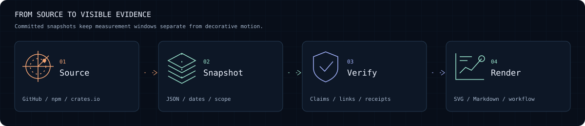

## The rUv approach to intellectual property

Build in public. Publish working code, dated evidence, and reproducible results. Credit the foundational research and distinguish original contributions from integration and implementation. The [prior art dossier](docs/ruvnet-prior-art.md) records lineage and scoped novelty claims; each repository's license governs reuse.

[Cognitum One](https://cognitum.one/) builds commercial value through enterprise integration, hardware, governance, support, and deployment expertise. Public provenance documents contributions; it does not by itself establish patent rights or exclusive ownership.

## Evidence and provenance

| Evidence | Purpose |
| --- | --- |
| [October proof record](docs/proof/2026-10-02.md) | Pinned source, registry releases, preserved limits, and a reproducible profile check |
| [Machine readable metrics](data/metrics.json) | Current counts, windows, caveats, and source links |
| [GitHub snapshot](data/github-stats.json) | Account, flagship, and recent repository traction from the public API |
| [Registry snapshot](data/registry-stats.json) | Known set npm and crates.io counts, dated snapshots, and counting rules |
| [npm search exclusions](data/npm-search-exclusions.json) | Published maintained packages omitted from npm maintainer search |
| [Package index](docs/ruvnet-packages.md) | Registry inventory and project family grouping |
| [Prior art dossier](docs/ruvnet-prior-art.md) | Dated lineage, creation metadata, and scoped claims |
| [Entity glossary](docs/ENTITY-GLOSSARY.md) | Canonical project names and measurement terms |
| [Claims policy](data/claims.json) | Evidence rules for lineage, public traction, verified usage, and novelty |

Repository lineage, public availability, feature evidence, public traction, verified usage, and novelty are distinct claims. A root commit anchors current history. It does not prove that every current feature existed at that date. Download events, clone events, stars, followers, and users are also kept distinct.

## Project archive

[Historical project catalog and monthly snapshots](README-archive.md) · [All repositories](https://github.com/ruvnet?tab=repositories) · [Prior art dossier](docs/ruvnet-prior-art.md)

Long live ❤️ Open Source.

### Daily ecosystem statistics

[Latest ecosystem report](docs/ecosystem-metrics.md) · [Running totals and coverage](data/ecosystem-running-totals.json)
