# rUv's contrastive AI walkthrough

[Original explanation: RuView issue #87](https://github.com/ruvnet/RuView/issues/87)

Six scenes, eight seconds each, in a repeating 48 second loop. Flowing connections, moving observation clusters, graph cut highlights, and a progressive drift trace illustrate the concepts. Reduced motion settings show the opening scene; use the individual slides below for the full explanation.

## 1. Complementary AI approaches

## 2. Learn similarity and separation

## 3. Inspect memory graph structure

## 4. Observe drift

## 5. Gate candidate updates

## 6. Connect the ruvnet workflow

## Scope

These are conceptual and synthetic diagrams, not measured performance results. Contrastive representation learning and graph coherence checks play different roles. Graph stability does not establish factual truth, and a passing structural check alone cannot authorize promotion. Evaluate the actual workload using held out data, drift monitoring, regression checks, cost and latency measurements, and the applicable approval policy.

[RuVector](https://github.com/ruvnet/RuVector) · [Ruflo](https://github.com/ruvnet/ruflo) · [MetaHarness](https://github.com/ruvnet/metaharness) · [RVM](https://github.com/ruvnet/rvm)
